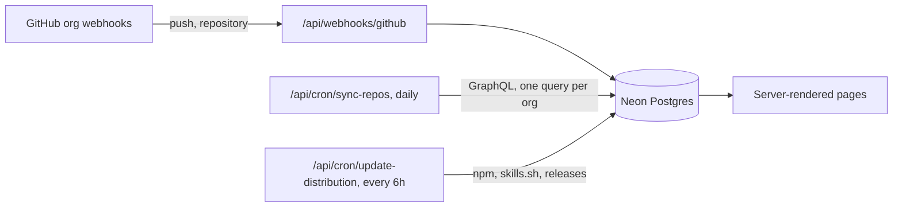

# Pulse

What Crafter Station ships, across its four GitHub orgs: crafter-station, crafter-research, crafter-lab and crafter-games.

Live at [pulse.crafter.run](https://pulse.crafter.run).

## What it shows

- **Overview (`/`)**: projects shipped, repos created, stars gained and npm downloads for the selected period, each compared with the previous period. Recently shipped projects, a per-member table, the repos that gained the most stars, and repos created per month.
- **Team (`/team`, `/team/[login]`)**: each core member's ships, repos, commits, a 12-week commit heatmap, the repos they created and their recent commits.
- **Projects (`/projects`, `/projects/[org]/[name]`)**: every repo, with search and filters for status, creator and sort, and a page per repo with its star history, recent commits and contributors.

Every number on the overview opens a drawer with the items behind it. The period (week, month or quarter) and the org are URL parameters (`?period=quarter&org=crafter-lab`), so any view can be shared as a link.

## Definitions

- **Repo created**: a non-fork repo whose GitHub creation date falls in the period.
- **Shipped**: a repo created in the period that has a homepage or a published package in the `packages` table.
- **Creator**: the sender of the `repository.created` webhook. For older repos, the author of the first commit (`creator_source = first_commit`).
- **Commits**: pushes to each repo's default branch by human authors, excluding future-dated commits. Bots never count.
- **Stars gained**: current stars minus the stars on the first day of the period, taken from the daily `repo_stats` snapshots.

Private repos count toward totals, but their names, messages and links are never shown.

## Team roster

`lib/roster.ts` is the source of truth for who appears by name. It mirrors [crafter.run/team](https://crafter.run/team).

- `CORE_MEMBERS`: the active core team. Add `aliases` when a member commits from more than one GitHub login.
- `FORMER_MEMBER_LOGINS`: never shown by name. Their commits still count toward org totals.
- `BOT_LOGINS`: excluded from every metric, together with any login ending in `[bot]`.

To add or remove a member, edit this file and open a PR.

## Data flow



- **Webhooks**: each org has a webhook for `push` and `repository` events pointing at `/api/webhooks/github`, signed with `GITHUB_WEBHOOK_SECRET`. Events from orgs missing from the `orgs` table are ignored.
- **Repo sync**: stores stars, forks, homepage, archived and fork flags, default branch and creation date, plus one `repo_stats` row per repo per day.
- **Distribution**: npm downloads, skills.sh installs and release downloads for the packages in `packages`.

## Stack

Next.js 16 with React 19 Server Components, Neon Postgres with Drizzle, and [ui-sdk](https://ui-sdk.dev) for the drawer, segmented control and select. Styling follows the [Crafter design guide](https://crafter.run/design.md): Crafter Sans, the paper and olive palette in light and dark, and a single yellow accent, all in `app/pulse.css`.

## Local setup

```bash
bun install
vercel env pull .env.local    # DATABASE_URL, GITHUB_TOKEN, GITHUB_WEBHOOK_SECRET, CRON_SECRET
bun dev                       # https://pulse.localhost via portless
```

Point `DATABASE_URL` at a Neon branch, not production, while developing (`neonctl branches create --project-id <id> --parent production`).

## Scripts

| Command | What it does |
| --- | --- |
| `bun run migrate:pulse-2` | Adds the repo metadata, creator and `repo_stats` schema, and registers the four orgs. Idempotent. |
| `bun run sync-repos` | Same as the daily cron: syncs repo metadata and today's star counts. `--org <slug>` for one org. |
| `bun run backfill --org <slug> --days <n>` | Loads commits from each repo's default branch. |
| `bun run backfill-creators --since <date>` | Attributes repos without a creator to their first commit author. |
| `bun run backfill-stars` | Rebuilds daily star history from stargazer timestamps. `--repo owner/name` for one repo. |

Star history from stargazers misses stars that were later removed, so the counts on past days can be slightly low. The current total always comes from GitHub.

## Adding an org

1. Insert a row into `orgs` (see `scripts/migrate-pulse-2.ts`).
2. Create an org webhook: payload URL `https://pulse.crafter.run/api/webhooks/github`, content type JSON, the same secret, events `push` and `repository`.
3. Run `bun run sync-repos --org <slug>`, `bun run backfill --org <slug> --days <n>` and `bun run backfill-creators`.
